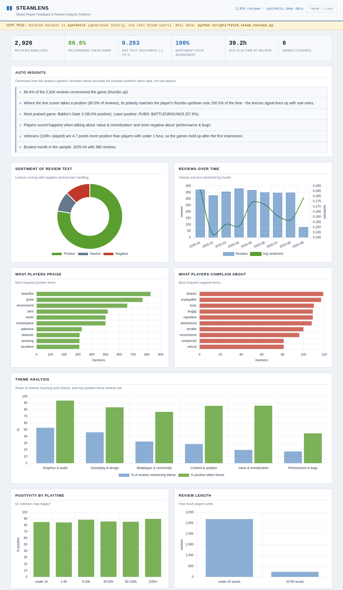

# SteamLens — Steam Player Feedback & Review Analysis Platform

A full-stack mini project: a data-cleaning and sentiment-analysis pipeline
over real Steam reviews, served as an interactive dashboard.



## What it does

1. **Collects** Steam reviews (`scripts/fetch_steam_reviews.py`, Steam's
   public `appreviews` API - no key needed). The repo ships with a
   clearly-labeled synthetic demo dataset so it runs out of the box
   (see *Data* below).
2. **Cleans** them (`scripts/clean_data.py`): empty rows, duplicates,
   non-English, ultra-short reviews, bad timestamps - every removed row is
   counted and shown on the dashboard.
3. **Analyzes** them (`scripts/analyze.py` + `scripts/sentiment.py`):
   transparent lexicon sentiment (negation + booster aware), theme
   detection, playtime/length trends, per-game comparison and auto-written
   insights.
4. **Serves** everything (`app.py`, Flask + JSON API) to an interactive
   dashboard (vanilla JS + Chart.js, vendored so it works offline).

## Run it

```bash
pip install -r requirements.txt
python run_pipeline.py     # clean + analyze (uses the bundled dataset)
python app.py              # dashboard at http://127.0.0.1:5000
```

Fresh data from Steam (run from your own network):

```bash
python scripts/fetch_steam_reviews.py          # default 6 games x 500
python scripts/fetch_steam_reviews.py 413150 300   # any appid + count
python run_pipeline.py && python app.py
```

Find appids on the game's store page URL, e.g. `/app/413150/Stardew_Valley/`.

## API

| Route | Purpose |
| --- | --- |
| `GET /api/summary` | KPIs, chart series, insights, cleaning report |
| `GET /api/games` | Per-game comparison rows |
| `GET /api/themes` | Theme analysis |
| `GET /api/reviews?q=&game=&sentiment=&voted=&sort=&page=` | Review explorer |

## Project layout

```
steamlens/
├── app.py                      # Flask server + JSON API
├── run_pipeline.py             # one-command pipeline runner
├── requirements.txt
├── data/
│   ├── raw/                    # raw review CSVs (input)
│   └── processed/              # cleaned CSV, enriched CSV, analysis.json
├── scripts/
│   ├── fetch_steam_reviews.py  # live Steam API collector
│   ├── clean_data.py           # stage 1: cleaning + funnel report
│   ├── sentiment.py            # lexicon sentiment scorer (no ML deps)
│   └── analyze.py              # stage 2: aggregation + insights
└── static/                     # dashboard (HTML/CSS/JS + vendored Chart.js)
```

## Data

The repo ships a **synthetic demo dataset** (3,018 generated reviews,
`scripts/generate_sample_data.py`) so everything runs out of the box. It is
machine-written filler, clearly not real user feedback.

For real reviews, two fetchers drop straight into the same pipeline:

```bash
python scripts/fetch_steam_reviews.py        # live: Steam's public API
python scripts/fetch_huggingface_sample.py   # the public HF mirror dataset
python run_pipeline.py && python app.py
```

The hosted analysis page for this project was produced from 3,000 public
Steam reviews (Hades, PUBG: BATTLEGROUNDS, Counter-Strike 2, Apex Legends,
Baldur's Gate 3, Rust; written March 2020 - August 2023) sampled on
23 Oct 2026 from
[`SebastianHops/steam-reviews-english`](https://huggingface.co/datasets/SebastianHops/steam-reviews-english).
That text is not redistributed here - see DATA_NOTICE.md.

## Sentiment approach

`scripts/sentiment.py` is a rule-based scorer built for gaming language:
~170 weighted positive/negative terms, negation flipping ("not good"),
boosters ("absolutely amazing"), length normalization, squashed into
[-1, 1]. On the bundled sample its polarity matches the reviewer's own
thumbs up/down 93% of the time when it takes a position.

## Ideas to extend

- Swap the lexicon for a transformer model (e.g. `cardiffnlp/twitter-roberta-base-sentiment`)
- Aspect-based sentiment per theme (what exactly about "performance"?)
- Compare review language before/after a big patch
- Add more games and a game-picker that fetches on demand

## Push this to GitHub

```bash
git init && git add -A && git commit -m "SteamLens dashboard"
gh repo create steam-review-intelligence --private --source=. --push
```

(Or create the repo on github.com and upload the files there.)
